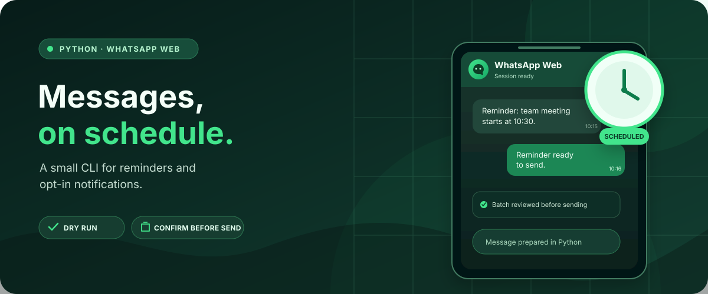

# WhatsApp Message Automation

[](https://github.com/MugdhoAI/whatsapp-message-automation/actions/workflows/ci.yml)
[](LICENSE)



Schedule and send opt-in WhatsApp reminders and notifications from Python through WhatsApp Web.

This is a small command line utility for controlled personal and internal workflows. It automates the normal WhatsApp Web interface with Playwright. It does not use private WhatsApp APIs or attempt to bypass authentication, CAPTCHAs, rate limits, or other platform protections.

## What it does

- Reads recipients and message text from a JSON file.
- Validates international phone numbers and message content before opening the browser.
- Supports dry runs so you can review a batch without sending anything.
- Sends a batch immediately or waits until a specified date and time before starting.
- Reuses a local browser profile for the normal WhatsApp Web login.
- Asks for confirmation before sending unless you explicitly pass `--yes`.
- Supports a configurable delay between messages.
- Records operational events in a local log.

The scheduler handles a single scheduled batch. Recurring reminders, contact-name lookup, message templates, and delivery-receipt verification are not currently supported.

## Quickstart

Requirements: Python 3.11 or newer, a WhatsApp account, a desktop browser environment, and Playwright.

Create and activate a virtual environment:

```bash
python -m venv .venv
```

On Windows PowerShell:

```powershell
.\.venv\Scripts\Activate.ps1
```

On macOS or Linux:

```bash
source .venv/bin/activate
```

Install the project and Chromium:

```bash
python -m pip install -e ".[dev]"
playwright install chromium
```

Create your message file:

```powershell
Copy-Item messages.example.json messages.json
```

On macOS or Linux, use `cp messages.example.json messages.json`. Edit `messages.json` with the intended recipients and message text. Each entry must contain only `phone` and `message`, and the phone number must use international format, such as `+8801700000000`.

Review the batch without sending:

```bash
python -m whatsapp_automation --file messages.json --dry-run
```

When the preview is correct, start the send operation:

```bash
python -m whatsapp_automation --file messages.json --send
```

The first run opens WhatsApp Web. Scan the QR code normally if you need to sign in. The tool asks for confirmation before sending. Review the preview carefully; it includes phone numbers and message text.

## Schedule a batch

Use an ISO 8601 date and time. Replace the example with a future time in your local timezone:

```bash
python -m whatsapp_automation --file messages.json --send --at "2030-01-01T10:30:00"
```

The tool asks for confirmation before waiting, unless `--yes` is supplied. Press Ctrl+C during the wait to cancel before sending. Keep the terminal session and computer running until the scheduled send starts. A date and time without a timezone offset is interpreted as local time.

## Configure the delay

The default delay between messages is three seconds. Set a different finite, non-negative delay with `--delay`:

```bash
python -m whatsapp_automation --file messages.json --send --delay 5
```

The delay is not a guarantee of delivery and does not bypass WhatsApp limits.

## Responsible use and privacy

- Send only to people who expect and have agreed to receive the messages.
- Do not use this project for spam, unsolicited bulk messaging, contact scraping, or attempts to evade WhatsApp protections.
- Use `--dry-run` first and review the exact batch before sending.
- Use `--yes` only when you have already reviewed the batch and intentionally want to skip the interactive confirmation.
- The persistent browser profile in `data/browser-profile` contains authenticated session data. Keep it private and never commit or share it.
- The dry-run preview displays message text in the terminal. The local activity log can contain operational errors, so review it before sharing logs publicly.

## Limitations

This project automates a third-party web interface, not an official WhatsApp API. WhatsApp Web can change and break browser selectors. A successful browser operation does not prove that every message was delivered or read. If a browser or network error occurs during a send, the message status may be uncertain; check WhatsApp before retrying. The tool does not automatically retry uncertain sends.

This is intended for small, controlled workflows. It is not a bulk-messaging platform and is not presented as production-grade messaging infrastructure.

## Development

Run the tests and linter:

```bash
pytest
ruff check .
```

The sender tests use a fake browser interface. They verify the automation calls without contacting WhatsApp, so they do not prove live website compatibility or message delivery.

## Project structure

```text
src/whatsapp_automation/
├── __main__.py
├── cli.py
├── models.py
├── scheduler.py
├── sender.py
└── validation.py

tests/
├── test_cli.py
├── test_scheduler.py
├── test_sender.py
└── test_validation.py
```

Input validation, scheduling, command line behavior, and browser interaction are kept in separate modules so most behavior can be tested without opening a browser.

## Contributing and security

Contributions should include focused tests and must not expose private message content or browser session data. See [CONTRIBUTING.md](CONTRIBUTING.md) for the development workflow and [SECURITY.md](SECURITY.md) for reporting security concerns.

## License

MIT. See [LICENSE](LICENSE).
